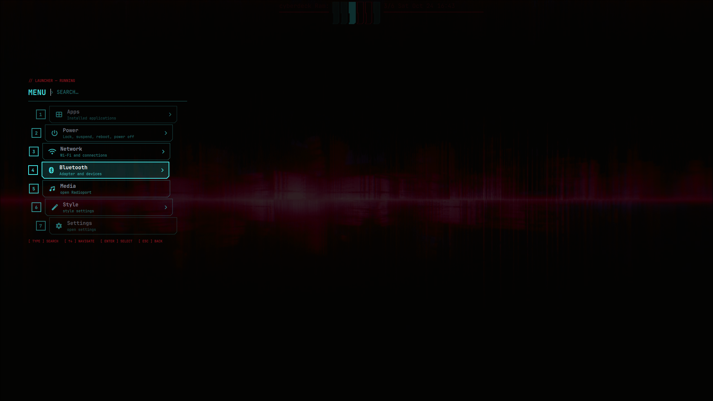
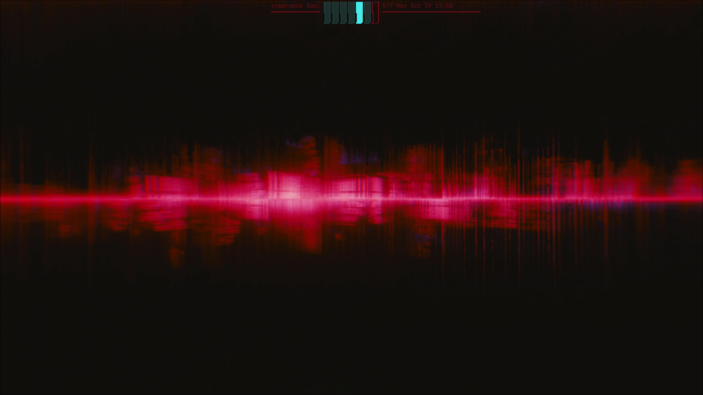
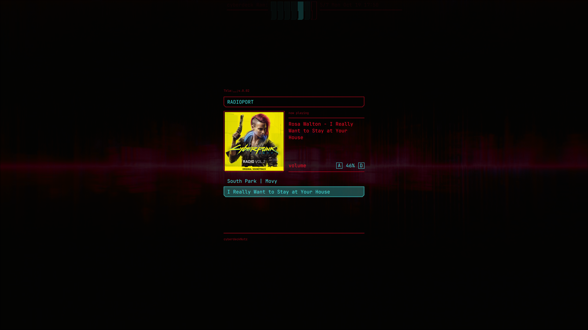
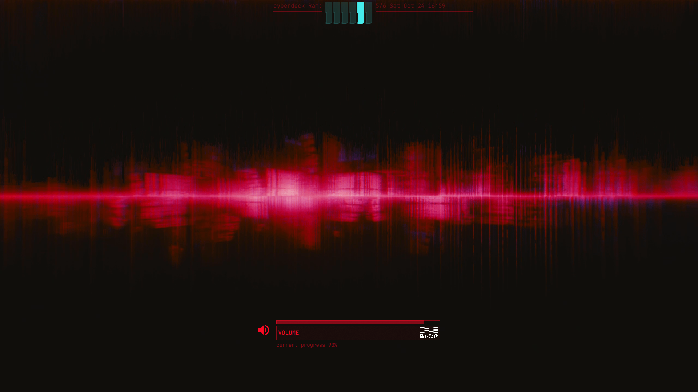
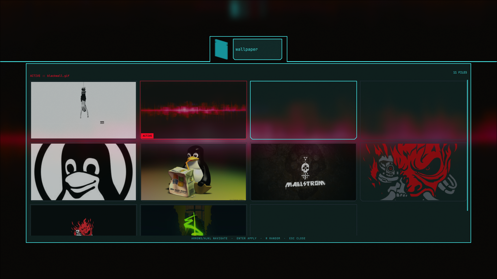
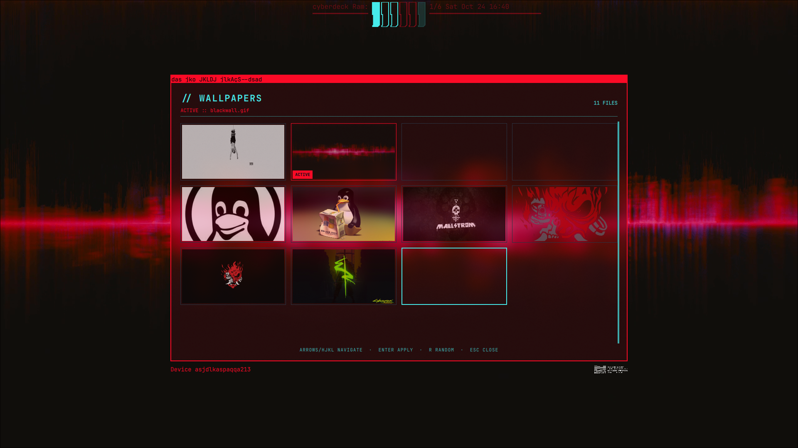
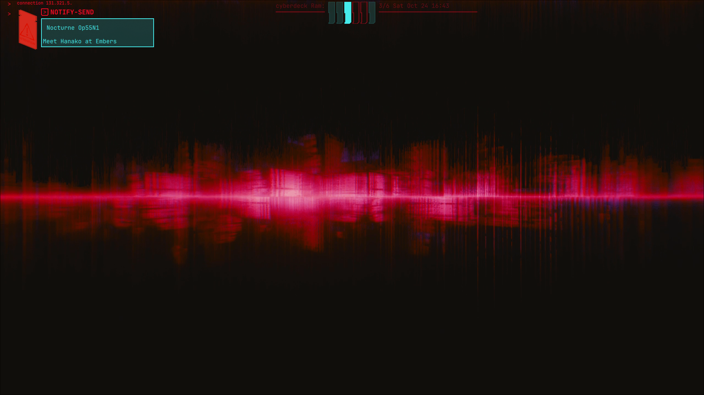

---
# CyberPunk Shell
---
## Objective

This project aims to make a quickshell inspired to cyberpunk 2077 cybrdeck

<table>
  <tr>
    <td></td>
    <td></td>
  </tr>
  <tr>
    <td></td>
    <td></td>
  </tr>
  <tr>
    <td></td>
    <td></td>
  </tr>
  <tr>
    <td></td>
  </tr>
</table>

---

## features until now

working app menu  
working wifi sub menu  
working bt sub menu  
working media player display  
ram that shows workspaces  
working volume osd  
working notifications  
working wallpaper settings  

---

## project structure

./Singletons, contains all the services and variables that only need one instance shared between the whole file  
./launcher, contains all the launcher related stuff  
./mediaplayer, contains all the mediaplayer related stuff  
./stats, contains all the components for the ram overlay  
./:  
 Theme.qml is a singleton that contains the theme colors and global sizes for cohesion  
 CybrShape.qml is a component used to recreate the classic cyberpunk shape, to be used instead of rectangles  
 GlitchReveal.qml is a wrapper that applies the glitch effect for when things pop up on the screen  
 Bar.qml contains the bar that reserve the space for itself (rn is empty)  
 shell.qml "spawns" all the other components  

## Start the project

have quickshell installed

clone this repo in: ~/.config/quickshell/

then run: qs
in the terminal to start it

### for the lsp

the lsp by default doesn't work you have to create a .qmlls.ini file in this folder

---

### To do

refactoring into smaller components especialy mediaplayer  
refactoring of a lot of the values (like widths and heights) from hardcoded to variables in singletons or in the roots  
adding features (rn Idk which, probably some bar widgets)  
exemples was for when I was laerning  
Creating new icons and adding existing ones in the code
Adding animations
Polish UI
Polish Keyboard navigation

---

## Raccomended settings for hyprland

hl.bind("SUPER + SPACE", hl.dsp.exec_cmd("qs ipc call launcher toggle"))  
hl.bind("SUPER + M", hl.dsp.exec_cmd("qs ipc call mediapanel toggle"))  

--blur to quickshell  
hl.layer_rule({  
 name = "quickshellBlur",  
 match = { namespace = "quickshell|quickshell:settings|quickshell:notifications" },  
 blur = true,  
 ignore_alpha = 0,  
})  

--volume  
hl.bind("XF86AudioRaiseVolume", hl.dsp.exec_cmd("wpctl set-volume -l 1.5 @DEFAULT_AUDIO_SINK@ 5%+"))  
hl.bind("XF86AudioLowerVolume", hl.dsp.exec_cmd("wpctl set-volume @DEFAULT_AUDIO_SINK@ 5%-"))  
hl.bind("XF86AudioMute",        hl.dsp.exec_cmd("wpctl set-mute @DEFAULT_AUDIO_SINK@ toggle"))  

---

### Thanks  

[doannc22212 quickshell-config](https://github.com/doannc2212/quickshell-config)  
learned how to make some of the components
